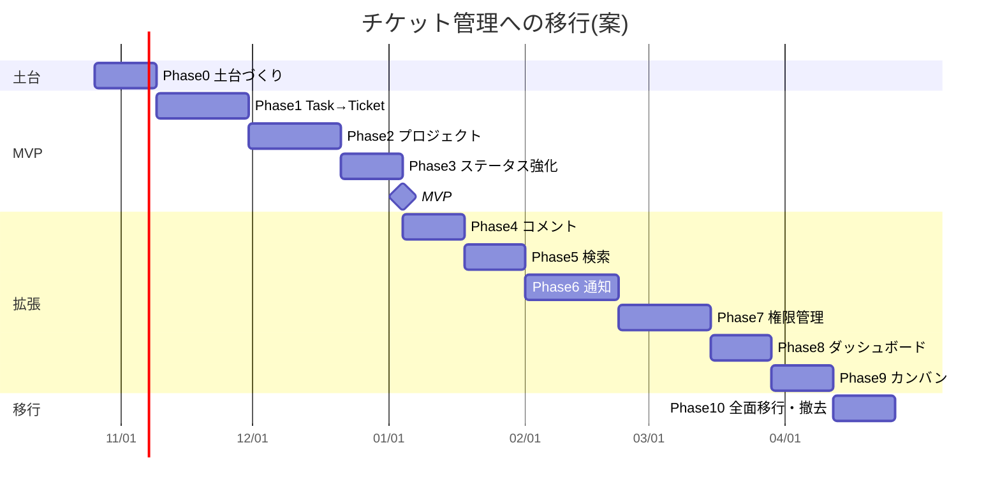

# ROADMAP — チケット管理システムへの移行(6 か月)

- 版: 0.2(2026-10-20、オーナーの回答を反映。PRD 10 章)
- 関連: [PRODUCT_VISION.md](PRODUCT_VISION.md) / [PRD_TICKET_SYSTEM.md](PRD_TICKET_SYSTEM.md) /
  [TASKS_TICKET_SYSTEM.md](TASKS_TICKET_SYSTEM.md) / [FEATURE_TOGGLE_STRATEGY.md](FEATURE_TOGGLE_STRATEGY.md)
- 前提: 開発はオーナー(確認・マージ)+ AI(実装・PR 作成)。1 つの PR は小さく、各 PR で CI が緑

---

## 1. 今のアーキテクチャの評価(2026-10-20、PR #39 時点)

### 1.1 全体像

| 項目 | 内容 |
|---|---|
| 規模 | 本体の Java 約 3,160 行(8 パッケージ + 起動クラス、47 ファイル)、画面のテンプレート 17 枚(部品を含む)、テーブル 5 つ(V1〜V11)、自動テスト 221 件 |
| 構成 | Spring Boot 3.3 / Java 21 / Thymeleaf / Spring Security / JPA / PostgreSQL 15 / Flyway。層ごとのパッケージ(`controller`・`service`・`repository`・`entity`・`form` など) |
| 品質の仕組み | Testcontainers での本物の DB テスト、CI(`test` + Docker のスモークテスト)が必須チェック、仕様とテストの対応表(`spec.md`)、壊してはいけないルール(INV-01〜14) |

### 1.2 ドメインモデル(今)

```
Task(ひな形・全員共通) 1 ── * TaskAssignment(人ごとの実体) * ── 1 User
  └ * TaskChecklistItem                └ * AssignmentCheck
User: role = ADMIN | MEMBER(MEMBER = 専用URLでログインする新入社員)
TaskAssignment: status = NOT_STARTED | IN_PROGRESS | DONE, dueDate, completedAt
```

チケット管理の目で見ると、**`TaskAssignment` が「チケット」に、`Task` が「チケットのテンプレート」に近い** 形です。
ただし `TaskAssignment` は「ひな形が必ずある」「1 人 1 タスク 1 回」「タイトルを自分で持たない」ので、そのままチケットにはできません。

### 1.3 評価

| 観点 | 評価 | 理由 |
|---|---|---|
| チケット管理への流用しやすさ | **高い** | 担当・状態・期限・完了日時・期限切れ・チェックリスト・集計の考え方がそのまま使える |
| テストと CI | **高い** | 移行中に「今の機能が壊れていない」ことを毎回自動で確かめられる |
| DB の変更管理 | **高い** | Flyway で「足すだけ」の変更を積み重ねられる。既存データがある前提の書き方も根付いている |
| セキュリティ | **中〜高** | 既定で管理者専用、他人のデータは 404、CSRF、セッションの無効化などがある。ただしロールが 2 種類だけ |
| レイヤー構造 | **中** | Service 層はあるが、Controller から Repository を直接呼ぶ箇所が残る(D1・D2・D6) |
| 汎用性 | **低〜中** | 名前・画面・ロールがオンボーディング専用(`Task`・新入社員・マイページ)。プロジェクトの概念がない |
| 規模への強さ | **中** | 一覧のページ分けがない、`open-in-view` が有効(D8)、ダッシュボードの全件読み込み(D7) |

**結論**: 作り直しは不要。**新しいドメイン(チケット・プロジェクト)を横に足し、共通部分を使い回し、最後にオンボーディングをその上に載せ替える**(段階的な置き換え)のが最小工数で安全。

### 1.4 使い回せる資産

| 今の資産 | チケット管理での使い道 |
|---|---|
| `User`・ログイン(`SecurityConfig`・専用URL・パスワード・初回変更・セッション無効化) | そのまま。Phase7 でロールを追加 |
| `AssignmentStatus` と `TaskAssignment.changeStatus`(完了日時の記録・消去) | `TicketStatus` と `Ticket.changeStatus` の手本(規則をそのまま写す) |
| `isOverdue`・`DateTimeDisplay`(`@dates`)・`Clock` | 期限切れの判定と表示をそのまま |
| `LinkText`(`@links.linkify`) | チケットの説明・コメントのリンク表示 |
| `ChecklistService`・`fragments/checklist.html` | チケットのチェックリスト、テンプレートからの起票時にサブ項目を写す |
| `AssignmentService.assignAllActive` の考え方 | 「テンプレートから一括起票」 |
| `ProgressFilter`・ユーザー一覧の絞り込み(URL に条件) | チケットの検索 |
| `DashboardService`・`Dashboard` | チケットのダッシュボード |
| `LoginSettings`(`app.member-login` の切り替え) | Feature Toggle の手本 |
| `fragments/nav.html`・`error/*.html`・`app.css` | 画面の共通部品 |
| テストの土台(`TestcontainersConfiguration`・`TestClockConfiguration`・`WebTestSupport`・`SampleData`・`BrowserSession`) | そのまま |
| CI(`changes` → `test` + `run-smoke`)、Codespaces、スキル、運用ルール | そのまま。スモークテストに Toggle ON の確認を足す |

---

## 2. エンジニアリングのレビュー

### 2.1 今の技術的負債(移行への影響順)

| # | 負債 | 移行への影響 | 対応フェーズ |
|---|---|---|---|
| D2・D6 | ユーザーの業務ルールが Controller にある(`UserPageController` 約 400 行、`MyPageController`) | Phase7(ロール追加)で同じルールを二重に書くことになる | Phase0 で `UserService` |
| D1 | タスクの登録・更新・削除が画面と API の 2 か所 | テンプレートとして使うとき、ルールが分かれる | Phase0 で `TaskService` |
| — | `Role.MEMBER` が「新入社員 + 専用URL」の意味を兼ねている | Phase7 でロールを増やすときに、ログイン方法の判定を広げる必要がある | Phase7(Q5: 分けずに「MEMBER 以外はパスワード」で広げる) |
| D8 | `open-in-view` が有効 | 新しい画面で知らないうちに N+1 が増える | Phase1 の前に(新画面は最初から関連を明示的に読む) |
| D5 | API が Entity をそのまま返す | チケットの API で同じ作りを真似すると、項目追加で外に漏れる | チケットの API は最初から DTO(Phase5) |
| D3 | `UserPageController` が大きすぎる | Phase7 の変更がぶつかりやすい | Phase0 後半 |
| D4 | マイページとユーザー詳細の表が重複 | チケットの表を作るときにさらに増える | Phase1(チケットの表は部品として作る) |
| — | 一覧のページ分けがない | チケットは件数が増える | Phase5 |
| — | サンプルデータが本番 DB にも入る(判断待ち) | チケットのサンプルも同じ問題を持つ | チケットのサンプルはマイグレーションに入れない(テストで作る) |
| — | 操作の履歴がない | チケット管理では「誰がいつ変えたか」が欲しくなる | 将来(Phase10 以降の候補) |

### 2.2 リファクタリング対象(移行の前提として先にやる)

| 対象 | 内容 | いつ |
|---|---|---|
| `TaskService` の導入(R1) | タスクの CRUD を Service に。後で「テンプレート」の Service として使う | Phase0 |
| `UserService` の導入(R2・R7) | ユーザーの登録・更新・削除・パスワード変更を Service に | Phase0 |
| `UserPageController` の分割(R3) | 割り当て・専用URLを別の Controller に(URL は変えない) | Phase0 |
| 画面の表の部品化(R4) | 割り当ての表を部品に。チケットの表も部品で作る | Phase1 |
| `FeatureFlags` の導入 | Toggle の土台 | Phase0 |

### 2.3 命名の改善案

| 今 | 問題 | 案 | いつ変えるか |
|---|---|---|---|
| `Task`(ひな形) | チケット管理の「タスク(チケットの種類)」と紛らわしい | 画面の表示名を「オンボーディングのひな形」に。クラス名は旧画面の退役まで変えない(変更範囲が大きいため) | 表示名は Phase2、クラス名は Phase10 で旧コードと一緒に整理 |
| `TaskAssignment` | 「割り当て」= チケットとの違いが分かりにくい | 新しいコードでは使わない。Phase10 でデータをチケットへ写して退役 | Phase10 |
| `AssignmentStatus`(NOT_STARTED…) | チケットの TODO… と 2 つになる | チケットは `TicketStatus` を新しく作る。対応表(NOT_STARTED→TODO など)を 1 か所に書く | Phase1 |
| `Role.MEMBER` の説明「新入社員」 | 一般メンバーと区別できない | 画面の表示名を「メンバー」に変え、「新入社員」はプロジェクト・ログイン方法で表す | Phase7 |
| `MyPageController`(`/me`) | オンボーディング専用 | `/me` はそのまま残し、チケットの「自分の担当」へ広げる | Phase8 |
| ルートパッケージ `com.example.onboarding`・`onboarding-progress-system` | 名前がオンボーディング専用 | **変えない**(全ファイルの変更・CI・Codespaces・ドキュメントへの影響が大きく、得られるものが小さい)。必要なら Phase10 の後に別途検討 | — |

### 2.4 パッケージ構成の改善案

今の層ごとの構成はそのまま残し、**新しい機能は機能ごとのパッケージ** に作ります(混在するが、新旧の境目がはっきりし、旧コードの削除が楽になる)。

```
com.example.onboarding
├─ config, controller, entity, form, repository, security, service, web   … 今のまま(旧オンボーディング + 共通)
├─ feature/        … FeatureFlags, Feature, RequiresFeature, FeatureToggleInterceptor, 管理画面
├─ ticket/         … Ticket, TicketStatus, TicketRepository, TicketService, TicketController, TicketForm, TicketView(DTO)
├─ project/        … Project, ProjectRepository, ProjectService, ProjectController, OnboardingTemplateService
├─ comment/        … Phase4
├─ notification/   … Phase6
└─ board/          … Phase9(カンバン)
```

- 機能のパッケージの中は「Controller → Service → Repository」の順を守る
- 機能同士は Service を通して呼ぶ(他の機能の Repository を直接使わない)
- テンプレートは `templates/tickets/*.html` のように機能ごとのフォルダに置く

### 2.5 今後の拡張性リスク

| リスク | 内容 | 対策 |
|---|---|---|
| ロールとログイン方法の混同 | `MEMBER` = 専用URL の前提がコードの複数箇所にある(`AppUserDetailsService`・`AccessLinkService`・`LoginSettings`) | Q5 の回答で分けないことに決定。「専用URLは MEMBER だけ、ほかはパスワード」を MANAGER・VIEWER に広げる。変更前に今のログインの動きを押さえるテストを足す |
| 権限チェックの抜け | 画面が増えると「見えてはいけないチケット」が見える危険 | 権限はクエリの条件で確認する(NFT-11)。ロール × 画面のテストを表で用意する |
| Toggle の放置 | Toggle が増えて分岐が読みにくくなる | 撤去 Issue を同時に作る。公開後 2 か月で技術的負債に載せる |
| 二重管理の期間が長引く | オンボーディング(旧)とチケット(新)の両方にデータがある | Phase10 の期限を決める。テンプレートからの起票(Phase2)で早めに新側へ寄せる |
| 番号の重複 | 同時に起票すると番号が重なる | 行ロックで採番 + 一意制約(project_id, number) |
| 性能 | チケットが増えると一覧・検索・ダッシュボードが遅くなる | ページ分け、索引(status・assignee_id・project_id・due_date)、集計は 1 クエリで |
| JavaScript の追加 | カンバンのドラッグで初めて JS を入れる | ボタン版を先に作る。JS は任意・少量・オーナーに相談(今の決まり) |
| データ移行の失敗 | Phase10 の写し替えで不整合 | 写した元を記録して二重にしない、件数の突き合わせ、バックアップ、1 トランザクション |

---

## 3. フェーズ一覧

| Phase | 名前 | 主な内容 | Toggle | DB 変更 | 目安 |
|---|---|---|---|---|---|
| 0 | 土台づくり | Feature Toggle の仕組み、`TaskService`・`UserService`、`UserPageController` の分割 | (仕組みだけ) | なし | 2 週 |
| 1 | Task → Ticket への一般化 | チケット(登録・一覧・詳細・編集・削除・ステータス)、`/admin/features` | `ticket-system` | V12 `tickets`、`feature_flags` | 3 週 |
| 2 | プロジェクト導入 | Project └ Ticket、番号 `KEY-n`、テンプレートから一括起票 | `project-management` | V13 `projects`、`tickets.project_id` | 3 週 |
| 3 | ステータス管理強化 | TODO / IN_PROGRESS / REVIEW / DONE / CLOSED | (`ticket-system` 配下) | `tickets.status` の CHECK を拡張 | 2 週 |
| ★ | **MVP** | Phase1〜3 で「チケット管理として使える」 | | | 約 10 週 |
| 4 | コメント | Ticket └ Comment | `comments` | `ticket_comments` | 2 週 |
| 5 | 検索 | 担当者・ステータス・キーワード・プロジェクト、ページ分け、チケット API | (`ticket-system` 配下) | 索引の追加 | 2 週 |
| 6 | 通知 | アプリ内通知(割り当て・コメント・期限) | `notifications` | `notifications` | 3 週 |
| 7 | 権限管理 | ADMIN / MANAGER / MEMBER / VIEWER、プロジェクトのメンバー | `extended-roles` | `users.role` の CHECK、`project_members` | 3 週 |
| 8 | ダッシュボード | チケットの集計、自分の担当 | `ticket-dashboard` | なし | 2 週 |
| 9 | カンバンボード | プロジェクトごとのボード | `kanban-board` | なし | 2 週 |
| 10 | 全面移行と後片付け | オンボーディングのデータをチケットへ写す、Toggle の撤去、旧画面の退役 | `onboarding-legacy` | データ移行 1 回 | 2 週 |

---

## 4. 6 か月ロードマップ(2026-10-26 開始の想定)



| 月 | 週 | やること | 終わったときの状態 |
|---|---|---|---|
| 1 か月目 | 1〜2 | Phase0 | Toggle の仕組みがある。Service 層の負債(D1・D2・D3)が減る。**見た目の変化なし** |
| | 3〜4 | Phase1 前半 | `tickets` テーブル。ON にするとチケットの一覧・登録ができる(既定 OFF) |
| 2 か月目 | 5 | Phase1 後半 | 詳細・編集・削除・ステータス、`/admin/features` で再起動なしに ON/OFF |
| | 6〜8 | Phase2 | プロジェクト、`ONB-12` のような番号、テンプレートからの一括起票 |
| 3 か月目 | 9〜10 | Phase3 | 5 段階のステータス。**MVP**: Codespaces で `ticket-system`・`project-management` を ON にして確認 |
| | 11〜12 | Phase4 | コメント |
| 4 か月目 | 13〜14 | Phase5 | 検索・ページ分け・チケット API |
| | 15〜17 | Phase6 | アプリ内通知 |
| 5 か月目 | 18〜20 | Phase7 | 4 ロールとプロジェクトのメンバー(事前確認あり) |
| | 21〜22 | Phase8 | ダッシュボード |
| 6 か月目 | 23〜24 | Phase9 | カンバン |
| | 25〜26 | Phase10 | データ移行、Toggle の撤去、旧画面の退役(オーナー確認後) |

- 各フェーズの公開(既定 ON)は、オーナーが Codespaces で確認してから、別の小さな PR で行う
- 遅れた場合は Phase8・9 を後ろへずらし、Phase10 の撤去は「既定 ON + 2 週間安定」の条件を守る(期限より安全を優先)

---

## 5. フェーズの詳細

各フェーズの Issue は [TASKS_TICKET_SYSTEM.md](TASKS_TICKET_SYSTEM.md) を見てください。

### Phase0 土台づくり(2 週・Toggle の仕組み)

- 目的: 移行で何度も触る部分(ユーザー・タスクの Service、Toggle)を先に整える
- やること: `FeatureFlags`・`@RequiresFeature`・テンプレートの `@features`、`TaskService`、`UserService`、`UserPageController` の分割、`open-in-view` の方針決め
- 終わりの条件: 見た目と動きは変わらない(221 件のテストがそのまま通る)。Toggle の ON/OFF をテストで切り替えられる

### Phase1 Task → Ticket への一般化(3 週・`ticket-system`)

- 目的: 今の「割り当て」と同じ考え方で、自由に起票できるチケットを作る
- やること:
  - `tickets` テーブル(V12)、`Ticket`・`TicketStatus`(TODO / IN_PROGRESS / DONE。`AssignmentStatus` との対応表つき)
  - `TicketService`(完了日時の規則は `TaskAssignment.changeStatus` と同じ)
  - 画面: 一覧(ステータス・担当者で絞り込み)・登録・詳細・編集・削除(論理削除)・ステータス変更
  - メニュー「チケット」(Toggle ON のときだけ)
  - `feature_flags` テーブルと `/admin/features`(再起動なしで ON/OFF)
  - スモークテストに Toggle ON の確認
- オンボーディング依存の除去: チケットは `Task`(ひな形)なしで作れる。担当者は任意(未割り当てを許す)。「新入社員」という言葉を使わない
- 権限: この段階ではチケット画面は **ADMIN だけ**(認証・認可の変更をしないため)
- 終わりの条件: Toggle OFF で今と見た目が同じ。ON でチケットの一連の操作ができる

### Phase2 プロジェクト導入(3 週・`project-management`)

- やること: `projects` テーブル(V13)と既定のプロジェクト `GEN`(既存のチケットを入れる)、`tickets.project_id`、番号 `KEY-n`、プロジェクトの一覧・登録・編集・アーカイブ、**テンプレートから一括起票**(有効なひな形 → 選んだ人を担当者にしてチケットを作る。サブ項目はチェックリストとして写す)
- Toggle OFF のとき: プロジェクトの画面は 404、チケットは `GEN` に入る
- 終わりの条件: オンボーディングの受け入れを、チケット側(プロジェクト `ONB` + 一括起票)でも試せる

### Phase3 ステータス管理強化(2 週・`ticket-system` 配下)

- やること: `TicketStatus` に REVIEW・CLOSED を追加(CHECK 制約を新しいマイグレーションで広げる)、状態の移り方の決まり(例: CLOSED からは REOPEN で TODO へ)、一覧の色分け、期限切れの判定を CLOSED にも対応
- 今の割り当ての 3 段階は変えない
- 終わりの条件: **MVP 完成**。オーナーが Codespaces で確認

### Phase4 コメント(2 週・`comments`)

- やること: `ticket_comments`、詳細画面にコメント欄、投稿・編集・削除(自分のものだけ)、リンク表示
- 終わりの条件: Toggle OFF でコメント欄が出ない。ON で書ける

### Phase5 検索(2 週・`ticket-system` 配下)

- やること: 担当者・ステータス(複数)・プロジェクト・キーワード・期限切れのみ、ページ分け、索引、`/api/tickets`(DTO)
- 終わりの条件: 1,000 件のテストデータでも一覧が速い(1 画面数回のクエリ)

### Phase6 通知(3 週・`notifications`)

- やること: `notifications` テーブル、出来事(割り当て・コメント・期限前日)から通知を作る仕組み、メニューの未読数、一覧と既読
- 期限前日の通知は、毎日決まった時刻に動く処理(`@Scheduled`)で作る。時刻は `Clock` から取る
- 終わりの条件: Toggle OFF で通知が作られない

### Phase7 権限管理(3 週・`extended-roles`・**事前確認あり**)

- やること: `users.role` に MANAGER・VIEWER(ログインはパスワード。PRD 2.3、Q5 の回答どおりロールとログイン方法は分けない)、`project_members`、権限表(PRD 2.2)をクエリ条件で実装、ロール × 画面のテスト
- Toggle OFF のとき: 2 ロール(ADMIN / MEMBER)の今の動き。MANAGER は MEMBER、VIEWER は見るだけとして扱う
- 終わりの条件: 4 ロールそれぞれで、見える・変えられる範囲がテストで確かめられている

### Phase8 ダッシュボード(2 週・`ticket-dashboard`)

- やること: トップページにチケットの集計(ステータス別・期限切れ・担当者別)と「自分の担当」。範囲はロールと参加プロジェクトで決まる。`/me` に自分のチケットも出す

### Phase9 カンバンボード(2 週・`kanban-board`)

- やること: プロジェクトごとのボード(ステータスの列)。まずボタンで隣の列へ動かす版。ドラッグは任意(JavaScript の追加はオーナーに相談)

### Phase10 全面移行と後片付け(2 週・`onboarding-legacy`・**事前確認あり**)

- やること:
  1. バックアップを取り、`task_assignments` → `tickets`(プロジェクト `ONB`)へ写す(写した元の id を記録、件数の突き合わせ)
  2. `onboarding-legacy` を OFF にして、旧画面から新画面へ案内する
  3. 2 週間問題がなければ、各 Toggle の撤去 PR と、旧画面・旧コードの削除 PR
  4. 古いテーブルを残すか消すかをオーナーと決める(消す場合もバックアップ後)
- 終わりの条件: Toggle が 0 個(または仕組みだけ)。オンボーディングはチケットのテンプレート機能として動く

---

## 6. リスクと対応

| リスク | 起きたら | 備え |
|---|---|---|
| フェーズが予定より延びる | 後半(Phase8・9)を後ろへ | MVP(Phase1〜3)を最優先。Toggle があるので途中で止めても今の機能に影響しない |
| 新機能の不具合 | すぐ OFF(再起動なし) | Phase1 で `/admin/features` を作る |
| 今の機能を壊す | Revert | 既存テストを消さない・弱めない。スモークテストは今の確認をそのまま残す |
| Codespaces での確認の負担 | 確認が追いつかない | `codespaces-check.md` に各フェーズの確認項目を 3〜5 個ずつ足す。公開 PR を小さくする |
| 権限の設計ミス | 見えてはいけない情報が見える | Phase7 までチケットは ADMIN だけ。ロール × 画面のテストを先に書く |
