# 上流工程の成果物(図と定義表)— オンボーディング進捗管理システム

- 版: 1.0(2026-10-16。PR #29 時点の実装に合わせて作成)
- 関連: [要件定義書](requirements.md) / [設計書](design.md) / AI 向け: [docs/ai/spec.md](ai/spec.md)
- 図は **Mermaid** という書き方で描いています。GitHub でこのファイルを開くと、図として表示されます
  (文字で書いてあるので、AI もそのまま読めます)

## 目次

1. [ユースケース一覧](#1-ユースケース一覧)
2. [業務フロー図](#2-業務フロー図)
3. [画面遷移図](#3-画面遷移図)
4. [状態遷移図](#4-状態遷移図)(割り当て / 専用URL / パスワード / タスク)
5. [ER 図](#5-er-図)
6. [シーケンス図](#6-シーケンス図)(専用URL / 初回ログイン / パスワードのリセット)
7. [CRUD 図(機能 × テーブル)](#7-crud-図機能--テーブル)
8. [画面項目定義(入力チェック)](#8-画面項目定義入力チェック)
9. [メッセージ一覧](#9-メッセージ一覧)
10. [コード定義](#10-コード定義)

---

## 1. ユースケース一覧

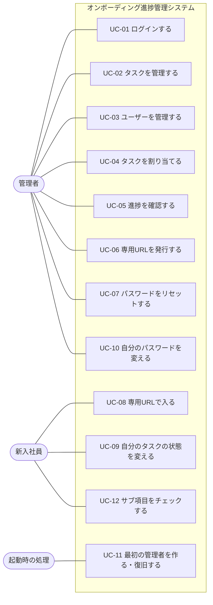

| ID | ユースケース | 利用者 | 関連する要件 |
|---|---|---|---|
| UC-01 | メールアドレスとパスワードでログインする | 管理者 | FR-30 |
| UC-02 | タスクを登録・編集・削除・並べ替えする | 管理者 | FR-01〜06 |
| UC-03 | ユーザーを登録・編集・削除する | 管理者 | FR-10〜12 |
| UC-04 | タスクを 1 件ずつ / まとめて割り当てる、割り当てを解除する | 管理者 | FR-20, FR-21 |
| UC-05 | ダッシュボード・ユーザー一覧・ユーザー詳細で進捗を確認する | 管理者 | FR-23〜25 |
| UC-06 | 専用URLを発行・再発行・無効化する | 管理者 | FR-31〜33 |
| UC-07 | ほかの人の仮パスワードを発行する | 管理者 | FR-38 |
| UC-08 | 専用URLを開いてマイページに入る | 新入社員 | FR-31 |
| UC-09 | 自分のタスクの状態を 未着手 / 対応中 / 完了 に変える | 新入社員 | FR-22, FR-35 |
| UC-10 | 自分のパスワードを変える(初回ログイン時の変更を含む) | 管理者(パスワード方式の新入社員も) | FR-36, FR-37 |
| UC-11 | 管理者がいなければ作る。設定があればパスワードを戻す | 起動時の処理 | FR-38, FR-39 |
| UC-12 | 自分のタスクのサブ項目を 1 つずつチェックする(全部チェックすると完了) | 新入社員 | FR-26 |

---

## 2. 業務フロー図

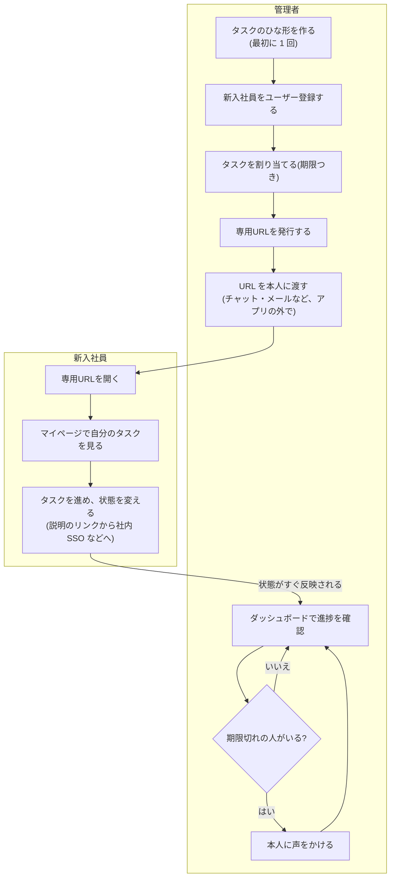

---

## 3. 画面遷移図

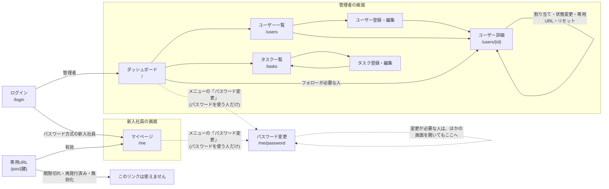

- ログインしていない状態で、ログイン画面・専用URL・ヘルスチェック以外を開くと、ログイン画面へ移動します
- 新入社員が管理者の画面を開くと、エラー画面(403「このページを表示する権限がありません」)になります

---

## 4. 状態遷移図

### 4.1 割り当ての状態(`task_assignments.status`)

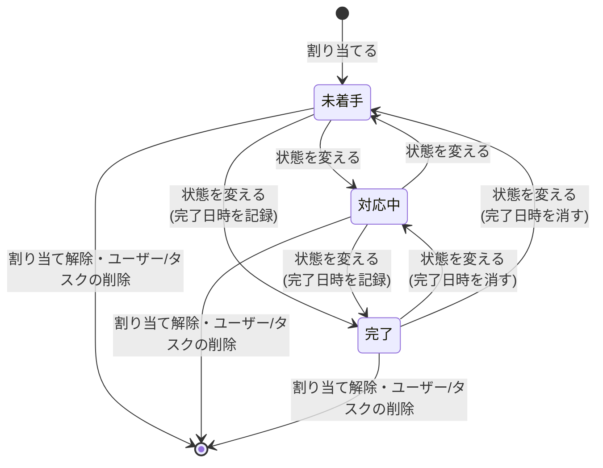

- どの状態からどの状態へも変えられます(管理者はユーザー詳細から、新入社員はマイページから)
- **「期限切れ」は保存された状態ではなく、表示するときに判定** します: 期限が今日より前 かつ 完了ではない
- 完了 → 完了 のように同じ状態を選び直しても、最初の完了日時は変わりません
- サブ項目があるタスクは、チェックでも状態が変わります(次の 4.1.1)

#### 4.1.1 サブ項目のチェックによる自動の変化

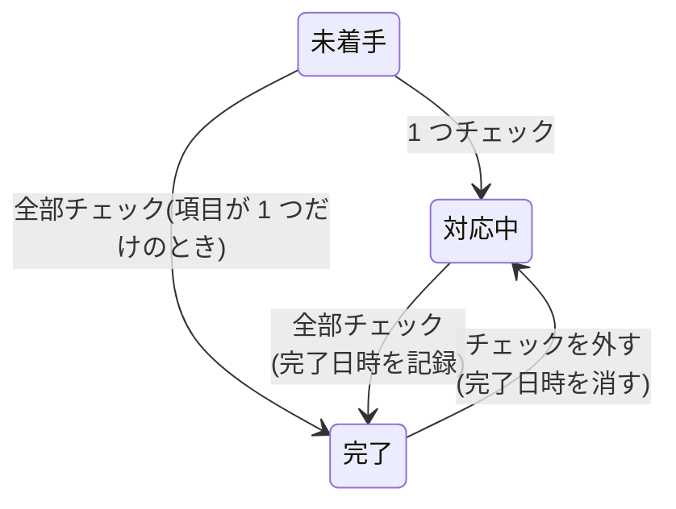

- チェックが 0 個になっても「未着手」には戻しません(完了からの場合は「対応中」、それ以外は今のまま)
- サブ項目の追加・削除だけでは状態は変わりません

### 4.2 専用URLの状態(新入社員ごと)

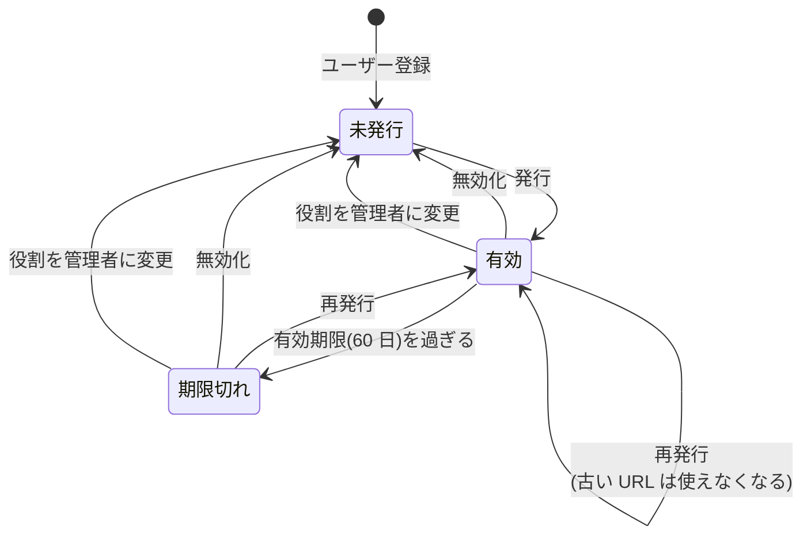

| 状態 | DB(`users`) | URL を開いたとき | ユーザー詳細の表示 |
|---|---|---|---|
| 未発行 | `access_token_hash` が NULL | — | 「まだ発行していません」+「専用URLを発行」 |
| 有効 | ハッシュあり、期限が今より後 | ログインして `/me` へ | 「発行済み(有効期限 …)」+「再発行」「無効にする」 |
| 期限切れ | ハッシュあり、期限が今以前 | 「このリンクは使えません」 | 赤い「期限切れ」+「再発行」「無効にする」 |

- 管理者は、どの状態でも専用URLを持ちません
- 無効化しても、すでにログイン中の画面はログアウトかセッション切れ(30 分)まで使えます(対応しないと決定済み)

### 4.3 パスワードの状態(パスワードでログインする人)

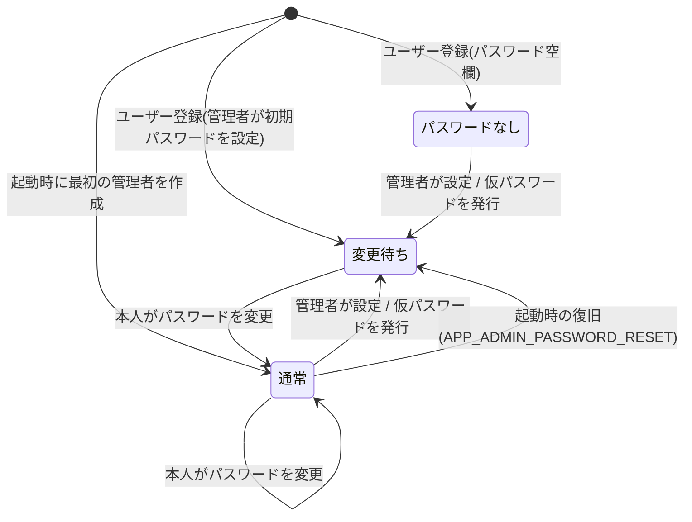

| 状態 | DB(`users`) | ログイン | ログイン後 |
|---|---|---|---|
| パスワードなし | `password_hash` が NULL | できない | — |
| 変更待ち | ハッシュあり、`password_change_required = true` | できる | パスワード変更画面以外は開けない(API は 403) |
| 通常 | ハッシュあり、`password_change_required = false` | できる | 通常どおり |

- 管理者が **自分自身** のパスワードを編集画面で設定した場合は、「変更待ち」にはなりません
- 専用URL方式の新入社員は、パスワードを使いません(この図の対象外)

### 4.4 タスクの状態

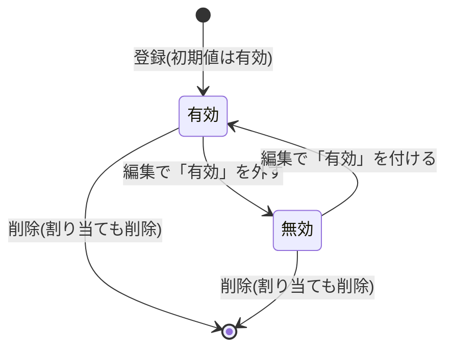

- 無効のタスクは新しく割り当てられません。すでに割り当てた分はそのまま残ります

---

## 5. ER 図

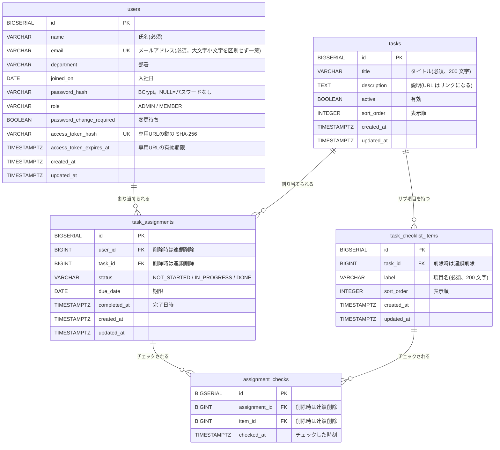

- `task_assignments` は `(user_id, task_id)` の組み合わせが一意(同じ人に同じタスクは 1 回だけ)
- `assignment_checks` は `(assignment_id, item_id)` の組み合わせが一意(行があれば「チェック済み」)

---

## 6. シーケンス図

### 6.1 専用URLの発行と利用

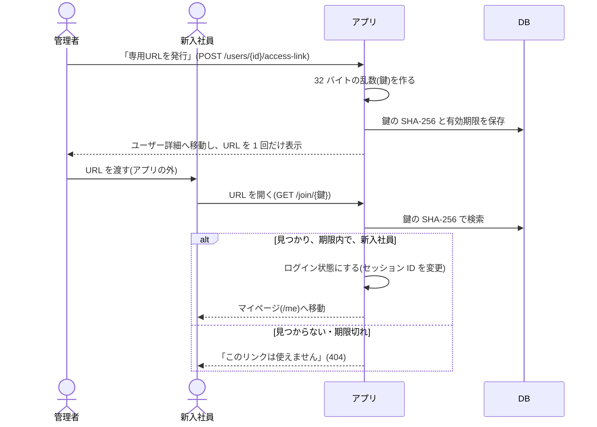

### 6.2 初回ログイン時のパスワード変更

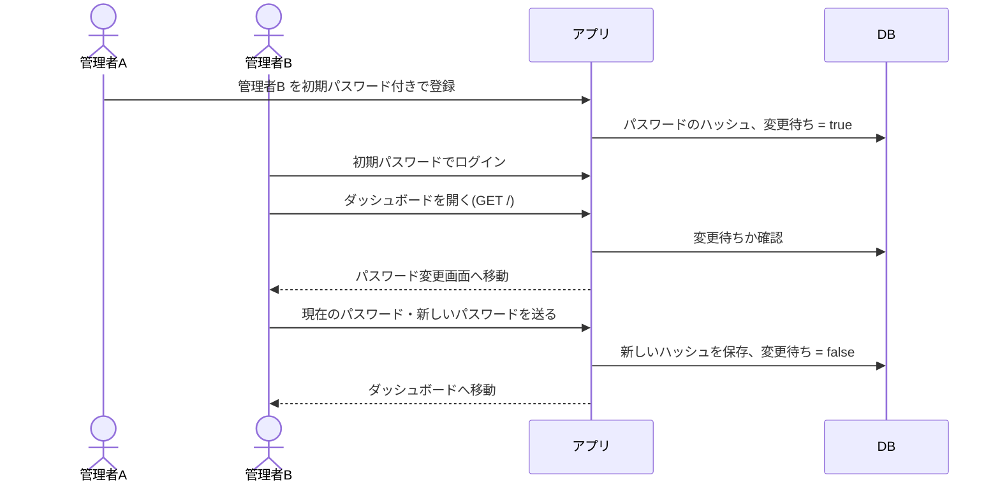

### 6.3 パスワードを忘れたとき

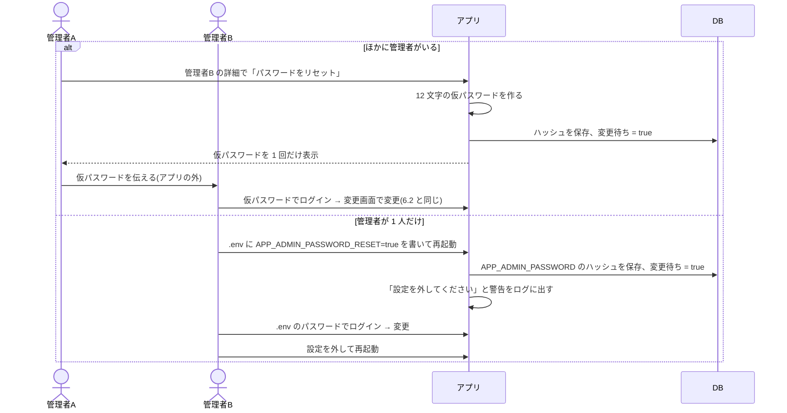

---

## 7. CRUD 図(機能 × テーブル)

C = 登録、R = 参照、U = 更新、D = 削除

| 機能 | tasks | users | task_assignments | task_checklist_items | assignment_checks |
|---|---|---|---|---|---|
| ログイン(パスワード) | | R | | | |
| 専用URLで入る | | R | | | |
| ダッシュボード | R | R | R | | |
| タスク一覧 | R | | | | |
| タスク登録・編集・並べ替え | C R U | | | | |
| タスク削除 | D | | D(連鎖) | D(連鎖) | D(連鎖) |
| ユーザー一覧(進捗・絞り込み) | | R | R | | |
| ユーザー登録・編集 | | C R U | | | |
| ユーザー削除 | | D | D(連鎖) | | D(連鎖) |
| ユーザー詳細 | R | R | R | R | R |
| タスクの割り当て(1 件 / まとめて) | R | R | C | | |
| 状態の変更(管理者 / 新入社員) | | R | U | | |
| 割り当て解除 | | | D | | D(連鎖) |
| 専用URLの発行・再発行・無効化 | | U | | | |
| パスワード変更・リセット | | U | | | |
| 起動時の管理者作成・復旧 | | C R U | | | |
| REST API(タスク) | C R U D | | D(連鎖) | D(連鎖) | D(連鎖) |
| マイページ | R | R | R | R | R |
| サブ項目の追加・削除(タスク編集) | R | | | C R D | D(連鎖) |
| サブ項目のチェック(新入社員) | | R | R U | R | C D |

---

## 8. 画面項目定義(入力チェック)

### 8.1 タスク登録・編集

| 項目 | 必須 | ルール | エラーメッセージ |
|---|---|---|---|
| タイトル | ○ | 前後の空白を除いて 1〜200 文字 | タイトルを入力してください / タイトルは200文字以内で入力してください |
| 説明 | | 自由(空欄可)。`http(s)://` の URL は画面でリンクになる | — |
| 有効 | | チェックボックス(初期値: 有効) | — |

### 8.2 ユーザー登録・編集

| 項目 | 必須 | ルール | エラーメッセージ |
|---|---|---|---|
| 氏名 | ○ | 100 文字まで | 氏名を入力してください / 氏名は100文字以内で入力してください |
| メールアドレス | ○ | メールの形式、255 文字まで、ほかの人と重複不可(大文字小文字は区別しない)。前後の空白は除く | メールアドレスを入力してください / メールアドレスの形式が正しくありません / メールアドレスは255文字以内で入力してください / このメールアドレスは既に登録されています |
| 部署 | | 100 文字まで(空欄可) | 部署は100文字以内で入力してください |
| 役割 | ○ | 管理者 / 新入社員。自分自身は管理者から変えられない | 役割を選択してください / 自分の役割は管理者から変更できません |
| パスワード | | 入力した場合のみ 8〜72 文字。編集で空欄なら今のまま | パスワードは8文字以上で入力してください / パスワードは72文字以内で入力してください |
| 入社日 | | 日付 | 日付の形式が正しくありません |

### 8.3 パスワード変更

| 項目 | 必須 | ルール | エラーメッセージ |
|---|---|---|---|
| 現在のパスワード | ○ | 今のパスワードと一致 | 現在のパスワードを入力してください / 現在のパスワードが正しくありません |
| 新しいパスワード | ○ | 8〜72 文字、現在のパスワードと違う | 新しいパスワードを入力してください / パスワードは8文字以上72文字以内で入力してください / 現在のパスワードと違うパスワードを入力してください |
| 新しいパスワード(確認) | ○ | 新しいパスワードと一致 | 確認のため、新しいパスワードをもう一度入力してください / 新しいパスワードと確認用のパスワードが一致しません |

- エラーで画面を出し直すとき、入力したパスワードは表示しません

### 8.4 タスクの割り当て(ユーザー詳細)

| 項目 | 必須 | ルール | エラーメッセージ |
|---|---|---|---|
| タスク | ○ | 有効なタスクで、まだ割り当てていないもの | 割り当てるタスクを選択してください。/ 選択したタスクが見つかりません。/ 無効(Active: No)のタスクは割り当てられません。/ このタスクは既に割り当てられています。 |
| 期限 | | 日付(空なら期限なし) | — |

### 8.5 サブ項目の追加(タスク編集)

| 項目 | 必須 | ルール | エラーメッセージ |
|---|---|---|---|
| サブ項目の名前 | ○ | 前後の空白を除いて 1〜200 文字 | サブ項目の名前を入力してください / サブ項目の名前は200文字以内で入力してください |

- タスクを登録した後の編集画面でだけ追加できます(登録画面には出ません)
- エラーは編集画面の上に赤い枠で出ます

---

## 9. メッセージ一覧

画面上部に、成功は緑の枠、エラーは赤の枠で表示します。

| 種類 | メッセージ | 出る場面 |
|---|---|---|
| 成功 | タスクを登録しました。/ タスクを更新しました。/ タスクを削除しました。 | タスクの操作 |
| 成功 | 「(タスク名)」を上に移動しました。/ 「(タスク名)」を下に移動しました。 | 並べ替え |
| 成功 | ユーザーを登録しました。/ ユーザーを更新しました。/ ユーザーを削除しました。 | ユーザーの操作 |
| 成功 | 「(タスク名)」を割り当てました。/ (件数)件のタスクを割り当てました。 | 割り当て |
| 成功 | 「(タスク名)」を「(状態)」にしました。 | 状態の変更 |
| 成功 | 「(タスク名)」の割り当てを解除しました。 | 割り当て解除 |
| 成功 | 専用URLを発行しました。/ 専用URLを無効にしました。 | 専用URL |
| 成功 | 仮パスワードを発行しました。/ パスワードを変更しました。 | パスワード |
| 成功 | サブ項目「(項目名)」を追加しました。/ サブ項目「(項目名)」を削除しました。 | サブ項目(タスク編集) |
| 成功 | 「(項目名)」にチェックしました。/ 「(項目名)」のチェックを外しました。 | サブ項目のチェック(マイページ) |
| 成功 | 「(項目名)」にチェックしました。すべて終わったので「(タスク名)」を完了にしました。 | 最後の 1 つをチェックしたとき |
| エラー | 割り当てられる有効なタスクはありません。 | まとめて割り当て |
| エラー | 自分自身は削除できません。 | ユーザー削除 |
| エラー | 管理者には専用URLを発行できません(管理者はパスワードでログインします)。 | 専用URL |
| エラー | 自分のパスワードは「パスワード変更」画面で変更してください。 | パスワードのリセット |
| エラー | メールアドレスまたはパスワードが正しくありません。 | ログイン |
| 案内 | ログアウトしました。 | ログアウト後 |
| エラー画面 | ページが見つかりません / このページを表示する権限がありません / リクエストを処理できません / エラーが発生しました | 404 / 403 / その他の 4xx / 5xx |
| エラー画面 | このリンクは使えません | 専用URLが無効 |

入力チェックのメッセージは 8 章を見てください。

---

## 10. コード定義

| コード | 値 | 画面の表示 | 保存先 |
|---|---|---|---|
| 割り当ての状態 | `NOT_STARTED` | 未着手 | `task_assignments.status` |
| | `IN_PROGRESS` | 対応中 | |
| | `DONE` | 完了 | |
| 役割 | `ADMIN` | 管理者 | `users.role` |
| | `MEMBER` | 新入社員 | |
| 進捗の絞り込み(ユーザー一覧) | `INCOMPLETE` | 未完了あり | URL の `?status=`(保存しない) |
| | `OVERDUE` | 期限切れあり | |
| | `COMPLETED` | すべて完了 | |
| | `UNASSIGNED` | 未割り当て | |
| 新入社員のログイン方法 | `link` | 専用URL | 環境変数 `APP_MEMBER_LOGIN` |
| | `password` | パスワード | |
